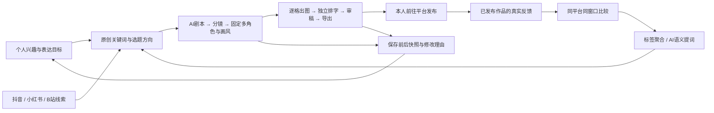

# 小冷漫画 · 创作反馈闭环（2026-10-23）

## 本轮需求与验收口径

| 用户需求 | 实现与边界 |
| --- | --- |
| 保留效果、修改、理由 | 每次有效保存保留完整 before/after JSON，时间、动作、理由及变更板块；个人页可展开对比；图片版本继续保留原文件。日志从本轮开始，不能补造以前没记录的修改理由。 |
| 知道哪篇表现好 | 逐作品、逐平台录入发布时间、观察时间、窗口、阅读/播放、点赞、评论、收藏、分享、标签与评论观察。保留每次观察，不覆盖旧数据。 |
| 提取关键词，指导下一篇 | 同平台、同观察窗口、同作品取最新记录；标签聚合平均阅读量；AI 可从真实剧本及反馈提取语义关键词与带记录ID的建议。结果保留为报告，由用户选择用于下一篇。 |
| 个人需求与网络需求 | 个人分析页区分「我想表达什么」和「读者回应了什么」。主观偏好与观测数据是两类证据；网络指标有平台分发、时间和样本偏差，并非绝对客观需求。 |
| 双界面 | 「漫画制作」保留原八步；「个人分析」含偏好与方向、作品反馈、修改时间线、素材档案；共享项目与顶部修改理由。 |
| 原创AI与热词辅助 | 原创入口不要求热点链接；继承已保存的角色、画风和个人偏好。抖音/B站热词可加入原创关键词，再提交原有AI编剧接口。 |
| 图片来源与画风拓展 | 六种本次对话原创的真实美术样张；GitHub案例原图外链、作者、许可及原提示词链接；改编提示词可填入草稿；支持上传参考、自定义描述、图片API生成样张、保存不可覆盖版本。 |

## 两条相互连接的流程

## 数据口径

- 工作区内的 `comicProject.json` 保存 creator、feedback、insightReports、assets、journal，以及原有作品/角色/画风。
- 每次有效保存先独占写入 `revision{uuid}.json`，记录不带 journal 的完整修改前后状态，再以乐观修订号原子保存项目。若保存冲突，旧文件不被覆盖，当前修改保留。中途失败可能留下未挂接快照，可人工检查；不自动清理历史。
- 本轮新增字段均有迁移默认值。画风参考的 license 为可选字段，避免仅因补默认字段改变旧作品图像指纹。
- 每次发布观察单独一条记录；不能把留空当 0，不能把重复观察相加。分析时对同一作品在当前平台/窗口取观察时间最近一条。
- 窗口为发布后24小时/7天/30天，观察时间允许目标时长前后20%，不能在未来。所选平台的原始统计口径由录入者核对。
- 每个关键词的平均阅读/播放量只计算存在阅读指标的作品；多个关键词可属于同篇作品，所以不同关键词的量不能相加。
- 互动次数比＝(点赞＋评论＋收藏＋分享)/阅读或播放。任一分子缺失或分母为0时不显示比率；该指标不是独立用户互动率，也不保证小于100%。
- AI分析每次最多使用当前组最新50篇，保留所有记录ID、平台、窗口、时间与建议，不自动更改原标签、原剧本或偏好；没有数据时禁止生成假报告。
- 暂未自动读取三个平台的本人创作者后台。录入与分析功能不代表已获得平台后台授权。

## 接口

- `GET /api/comicStudio/topics?source=bilibili`：固定请求B站公开搜索热词接口，只返回词、榜位、热度、采集时刻与搜索链接；不是视频剧情采集。上游可变化或限流，不需要填Cookie。
- `POST /api/comicStudio/plan`：现有AI编剧接口。原创选题由前端构造来源为「原创灵感」、空URL的素材对象；走相同输入校验与文字服务，不要求先搜热点。
- `POST /api/comicStudio/analyze`：mode/codexModel或已配置providerId/modelId，platform/window/interests/avoid以及1–50条实际作品记录。返回summary、keywords[{word,reason,evidenceIds}]、direction；服务端校验证据ID。
- `POST /api/ai/media/generate`：现有图片接口，mediaType=image。自定义画风样张使用该入口，返回图片保存为风格参考，并登记提示词/模型/生成方式。
- 所有新增服务接口保持本机/应用请求校验；不接收用户自定义远程采集URL，不保存平台口令到作品。

## 图片在哪里、如何生成

软件项目：`outputs/comicStudio`。

现有双角色四格工作区：
`outputs/comicStudio/data/workspaces/comicf69ad12f53b049f681788aad052db5d1/assets/`

其中包含 `xiaolengRole.png`、`xiaonuanRole.png`、`xiaolengPanel01.png` 至 `xiaolengPanel04.png`。它们是上轮对话调用原生 image_gen 后导入的原创图片，不是软件自动调用 Codex CLI 生成。原生工具的默认副本仍在 `~/.codex/generated_images/01a16289-7b4d-72b3-97ae-6854b832f890/`，使用和备份应依赖工作区副本。

新六画风样张：`apps/web/public/styleExamples/styleSheet.png`。完整本轮生成提示词与来源记录在 `outputs/creatorRound/styleSheetProvenance.json`。界面通过背景定位显示六块，没有将样张当作当前角色的身份参考。

「软件图片 API」与「对话生成后导入」明确分开。软件的 Codex CLI 目前承担文字结构化任务；图片服务需要在设置中配置相应供应商。素材档案允许补录来源、作者、授权用途、模型和提示词；未知项保持未知，不猜测模型ID或把可访问当成已授权。发布包包含 assetProvenance.json。

## GitHub与设计参考

- [Buffer Insights](https://buffer.com/insights)：参考作品表现比较与下一步内容行动；未声称其支持小红书。
- [awesome-gpt4o-images](https://github.com/jamez-bondos/awesome-gpt4o-images)：已读取README。图片逐例声明 © 2025 @jamez-bondos / CC BY 4.0，并列出提示词作者。界面使用外链原图和原提示词页面，不把第三方图片打包成自有素材。纸艺例含既有角色，仅学习纸艺方法；实际提示词改为原创现代生活人物。
- [ImgEdify/Awesome-GPT4o-Image-Prompts](https://github.com/ImgEdify/Awesome-GPT4o-Image-Prompts)：已读取README与MIT LICENSE，作为更多案例入口。合集许可不能代替具体商标、人物与第三方作品的权利记录。
- 六种内置画风提示词为本项目撰写；本轮样张为对话生成，未照搬具体画师姓名或GitHub案例的既有角色。

## 需求判断

「热词＋原创剧情」可以减少每天追逐事件的压力。热词作为触发器，个人偏好确定表达，真实发布记录帮助挑选下一次值得试的方向。先记录再比较；不能在没有真实样本时承诺流量增长。持续优化由保存日志、手动反馈和按需AI复盘完成，本轮没有创建后台定时任务、自动发帖或账号授权。
