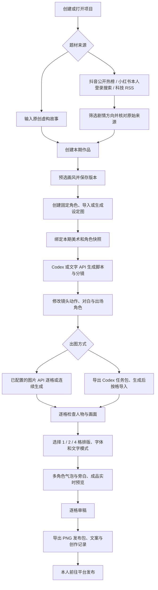

# 小冷漫画：从选题到成品

当前产品制作静态漫画：支持连续多格、中文排字、审稿与图片发布包。配音、镜头动画、视频剪辑与自动发布尚未实现。

## 一期作品的流程

已有风格和角色的项目可直接复用，既有作品保留本期快照。软件的八个页面支持直接跳转，不必机械重复已经完成的步骤。没有角色与画风的作品先引导到素材设定，再回到编剧。

## 固定多角色

项目角色库支持多位原创角色；每位分别保存角色 ID、名字、外形与服装说明、设定图。每格分镜可多选出场角色。图片提示词只包含该格出场角色，并附对应参考图、风格图和上一格图。联合设定图会去重，避免重复传入同一张图片。

使用支持多参考图的生成模型时，多位角色可在同格互动。通用图片模型仍可能出现脸型、服装、配饰或道具变化，角色库不等于已接入专门训练的一致性模型；审稿是必要步骤。

角色设定图有两条路径：填写身份描述后使用已配置的图片 API 生成，或者导出 Codex 角色包，在 Codex 中生成后导入。未配置凭证的预置模型不能当作已连接服务使用。

## 分镜与中文排字

每格独立保存画面、出场角色、脚本对白、多角色气泡、旁白与气泡位置。脚本生成按“角色名：台词”逐行返回对白，自动拆成角色气泡。修改分镜对白会重新拆分；排版页直接编辑气泡文字并同步脚本对白。

- 留白排字：默认给文字留出独立区域，多气泡按阅读顺序分列；图片完整缩放，避免盖住人脸和关键动作。
- 图内气泡：可拖动，并用方向键微调位置，选择说话角色及宽度。对话超界或相互重叠时显示原因，阻止将错误排版导出。
- 旁白置于底部独立色带；每页可排 1、2 或 4 格，输出 1080×1440。
- 字体包含系统黑体、系统宋体和内置霞鹜文楷。文楷来自官方开源仓库，保留 OFL 许可；字体实际绘制进 PNG，读者无需安装。
- 成品预览在图片齐全后随排版修改自动更新。修改字号、字体、气泡、背景或格数会改变审稿依据。

## 创作设置的实际作用

本软件只展示与当前流程直接相关的创作设置；原无限画布的插件、通讯、节点等设置仍属于高级画布，不冒充漫画设定。

| 设置 | 作用 |
| --- | --- |
| Codex / 文字 API | 控制选梗与脚本使用哪条实际生成路径 |
| Codex 模型 ID | 传入本软件的 CLI 调用，不修改全局模型 |
| 编剧推理强度 | 单次编剧调用的 low / medium / high / xhigh，默认 medium；选梗固定 low |
| 文字 API 模型 | 从实际添加的文字供应商中选择 |
| 图片 API 模型 | 控制角色与分格生成；缺少必需凭证的模型标注并禁用 |
| 纸白 / 夜间 | 改变工作台背景、卡片、文字与表单对比度 |
| 松绿 / 湖蓝 / 暖橘 | 改变主操作按钮与强调元素 |
| 标准 / 大字 | 改变工作台的正文与表单阅读大小 |

这些设置自动保存；作品字体、格数、页面底色和文字模式保存在各期作品，而不是供应商配置中。供应商凭证不是“验证通过”的证明，实际调用仍可能因额度、模型权限或服务能力失败。当前机器未配置图片 API 凭证，不将付费出图记作实测通过。

## 来源与品牌

小冷漫画是本次改造后的产品名称与原创雪花气泡标志；首页、标题、图标和成品页脚使用新品牌。基于 Toonflow 的 MIT 许可代码，版权与许可声明保留，并在“来源与许可”说明。

界面与流程研究参考 [Boords 多角色](https://assets.boords.com/blog/introducing-multi-character-storyboards)、[Clip Studio 漫画制作](https://www.clipstudio.net/en/comics-manga/comic-creation/)、[分格工具](https://www.clipstudio.net/en/comics-manga/tool/paneling/)。六类美术预选由本项目编写提示词和示意图，附 Adobe、Clip Studio、MoMA、The Met 等原始参考入口，不复制第三方人物或作品图片。

## 2026-10-23 创作闭环扩展

新增个人分析、发布反馈、修改前后快照、原创AI入口、B站热词与素材来源记录。完整需求口径与接口见 [creatorFeedbackWorkflow.md](creatorFeedbackWorkflow.md)。旧流程与验证记录保留，不把过去未记录的信息补造成历史。
